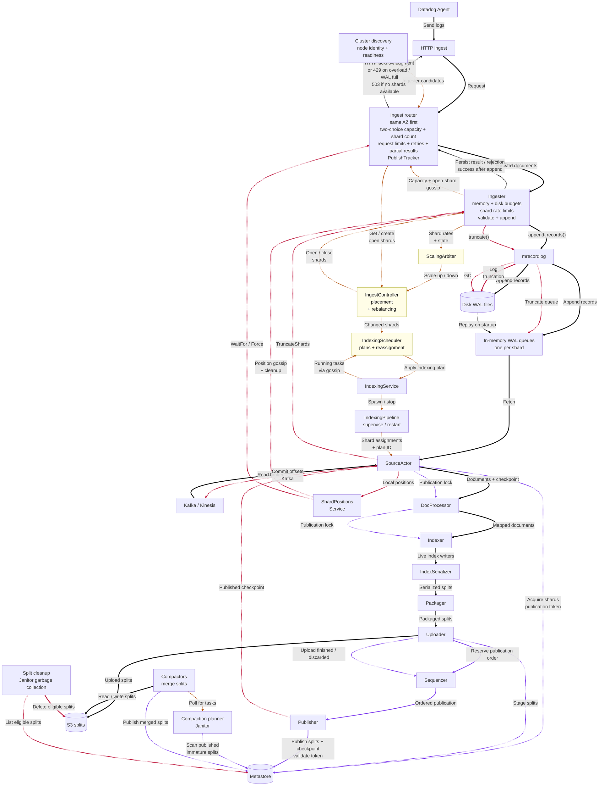
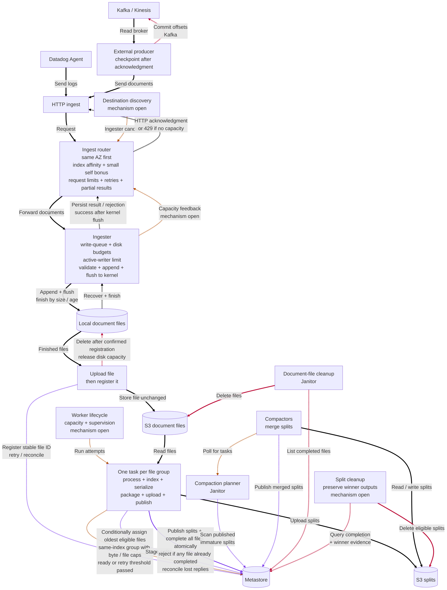
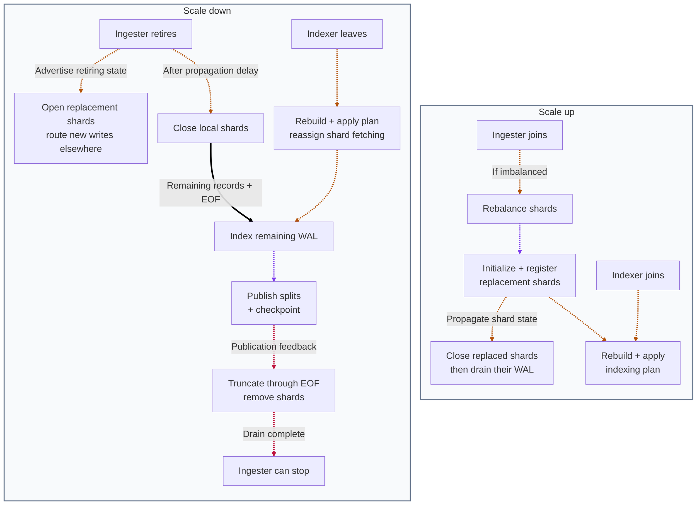
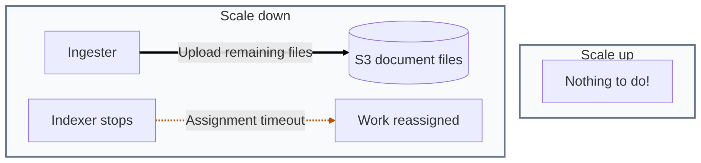

# Current ingestion vs. ingesthree

This compares two ways to get data into Quickwit:

- **Current:** HTTP ingestion uses shards and streaming fetch. Kafka-style sources feed indexing pipelines directly. The control plane assigns work.
- **ingesthree:** Clients send data through the ingest API. Ingesters write files and upload them to S3. Independent pipelines self-assign files and index them.

The comparison covers delivery guarantees, durability, latency, recovery, scaling, resource costs, architectural complexity, and configuration/tuning complexity.

**Primary motivation:** I consider the current ingestion architecture **overengineered** and want to remove **useless complexity** that has caused incidents.

Other advantages include decoupled ingestion and indexing, a shared S3 input backlog, and recovery on any pipeline.

## The two paths

Both designs show routing/admission, local persistence/recovery, work assignment, indexing, publication, and cleanup. Arrow colors: **black = data + ACKs**, **amber = coordination**, **purple = metadata + publication**, **red = checkpoints + reclamation**. Dotted arrows show control, responses and feedback. Layout follows the connections, not execution order. CPU/memory/scratch/upload limits remain on both sides and are not expanded here. Both graphs use standalone compaction: the Janitor's compaction planner scans published immature splits in the metastore, and separate Compactor nodes poll for merge tasks. V2 supports this mode; ingesthree requires it. Indexers publish to the metastore without notifying a local merge planner.

**Implementation versus design:** the current graph shows implemented mechanisms. The ingesthree graph shows the selected design, including required responsibilities whose mechanisms remain open. Local storage, write admission and file finishing are implemented; production routing, S3 handoff and distributed indexing are not yet connected. Separate current stage nodes represent separate actors/mailboxes. Ingesthree's single indexing node represents one attempt owner, not less indexing work.

### Current ingestion

Yellow nodes belong to the control plane. The diagram keeps full-size labels rather than automatically shrinking to the page width.



The pipeline has eight stage actors plus a supervisor. Each pipeline uses either ingest shards or an external source. Batch messages carry checkpoint/publication state forward. Edge labels describe responsibilities rather than enumerate Rust message types. [7][9][11]

**Routing:** v2 already prefers the same AZ. Among eligible nodes it samples two, prefers higher WAL free-capacity score, and breaks ties by open-shard count. It has no extra self preference. Discovery, readiness checks, request limits, retries and partial-result handling are shared responsibilities, not ingesthree additions. [Selection](quickwit/quickwit-ingest/src/ingest_v2/routing_table.rs#L86), [capacity feedback](quickwit/quickwit-ingest/src/ingest_v2/router.rs#L603), [request handling](quickwit/quickwit-ingest/src/ingest_v2/router.rs#L573).

**Overload responses exist in ingest v2 too:** WAL-full and router load-shedding errors map to HTTP 429. `NoShardsAvailable` maps to HTTP 503, including when shard selection fails because rate capacity is exhausted. The graph shows these response paths explicitly. [Error mapping](quickwit/quickwit-ingest/src/error.rs#L97), [router admission](quickwit/quickwit-ingest/src/ingest_v2/router.rs#L583), [ingester admission](quickwit/quickwit-ingest/src/ingest_v2/ingester.rs#L435).

**WAL storage:** `mrecordlog` is an ingester-owned library with per-shard in-memory queues and shared disk WAL files. Fetch reads the queues through `range()`. Startup replays the disk WAL into the queues. These are application-memory payloads, separate from the OS page cache. [13]

**Append, truncation, and file reclamation are distinct operations:** `append_records()` writes an append record to the WAL, applies the persistence policy, and adds payloads to the in-memory queue. `TruncateShards` reaches the ingester, which calls `mrecordlog.truncate()`. That call appends a `Truncate` record to the WAL, evicts queue entries through the supplied position, runs GC, and applies the persistence policy. GC preserves empty-queue positions when needed and deletes eligible whole WAL files. Queue truncation can therefore release memory while shared-file references keep disk usage unchanged. The graph shows separate edges for each operation. [Pinned implementation](https://github.com/quickwit-oss/mrecordlog/blob/3b3562efea468a3a72a244b16d3c555db0ddc95b/src/multi_record_log.rs#L249-L311), [ingester call](quickwit/quickwit-ingest/src/ingest_v2/state.rs#L603).

**Rebalancing and reassignment are separate protocols:** [12]

- **Ingester rebalancing:** open replacement shards, wait for discovery, then close the originals. Existing input drains from the old shards.
- **Indexing reassignment:** change which pipeline reads which shards. Removing an unfinished shard resets fetch streams, kills the old publish lock, and discards uncommitted pipeline work. Adding shards re-acquires the assigned set with a shared publication token.

### ingesthree



**Routing:** reuse the application router's payload forwarding and retry/result handling, adapting selection to file ingestion. Among eligible ingesters, prefer the same AZ, then continuing this index's existing file, with a small self bonus among comparable destinations. Affinity is a preference. Multiple writers per index remain allowed, including across AZs or under overload. The router forwards documents and returns the HTTP result. It does not redirect the client. Exact selection and feedback mechanisms remain open.

**Transition from v2:** keep router/ingester paths and destinations separate. The ingesthree router targets only ingesthree ingesters without shard discovery and sends `ingest-version: ingesthree`. Ingesthree rejects missing or incorrect headers before admission or writes. Move incoming traffic to ingesthree routers and let v2 drain its accepted backlog before retirement. No per-index version setting, negotiation, or cross-version fallback. [Decision](design_answers.md#transition-from-ingest-v2-agreed).

Each indexing pipeline is one task: read the input, process documents, build and serialize splits, package them, upload them, and publish them. These are internal steps with no separate stage actors or actor mailboxes. Use `QW_ENABLE_IN_MEMORY_INDEXING` for construction, then finalize splits to disk for packaging/upload. Fully disk-free indexing is outside the chosen requirements. [14] Indexing ends at `PublishFileSplits` in the metastore. The standalone compaction planner discovers the published splits from durable metadata. Ingesthree has no indexer-local `MergePlanner`/`NewSplits` handoff. Independent pipelines provide concurrency. CPU/IO scheduling, memory limits, and output scratch-space accounting remain necessary.

After S3 handoff, available pipelines select eligible files oldest first and may group files for the same index, capped by input bytes and file count. Assignment checks eligibility and records the new processing start atomically in the metastore. Once the retry threshold passes, another attempt may start while the earlier one retains publication rights. Retry groups may overlap. Publication succeeds only if every contributing input is still unfinished, then publishes all outputs and completes all inputs in one transaction. If any input already completed, the entire group's publication is rejected. Request load balancing, worker capacity management, and draining remain.

**Compaction is required and discovered through the metastore:** ingesthree indexers require `enable_standalone_compactors: true`. Run the existing planner on a Janitor node and merge workers on separate Compactor nodes. The planner periodically scans published immature splits, including after restart or after the publishing indexer stops. All live indexers, including v2 indexers during migration, must advertise standalone mode before the planner starts scanning. This removes the indexer-to-merger notification, while split publication to the metastore remains required. [Startup validation](quickwit/quickwit-serve/src/ingesthree.rs#L32), [file publication](quickwit/quickwit-indexing/src/ingesthree/mod.rs#L221), [planner scan and migration gate](quickwit/quickwit-compaction/src/planner/compaction_planner.rs#L164), [decision](design_answers.md#compaction).

**Cleanup on both sides:** current split GC uses metastore state and grace periods to remove eligible unpublished/deleted splits. Ingesthree retains split cleanup and must preserve winner outputs when reconciling competing attempts. Its graph also shows the added document-file cleanup. Neither graph claims that every orphan/late-upload cleanup case is settled. [Current split GC](quickwit/quickwit-index-management/src/garbage_collection.rs#L105).

**S3 input deletion:** delete after atomic split publication and file completion. Uploading splits alone is insufficient. The implemented Janitor GC pass lists completed inputs from the metastore and deletes their stored objects. Failed deletions are retried on later passes. Completion evidence is retained to reject duplicate registration, and subsequent scans also catch re-uploaded completed inputs. [Completed-file cleanup](quickwit/quickwit-janitor/src/completed_file_cleanup.rs#L25), [GC integration](quickwit/quickwit-janitor/src/actors/garbage_collector.rs#L237). Unregistered uploads and abandoned output splits need separate cleanup rules.

**Backpressure:** admission requires room in both the write queue and the local-storage budget, including reservations. Slow writes fill the queue. Slow uploads or registration can fill local storage while the queue remains empty. The ingester enforces both limits. The router can try another destination and returns HTTP 429 when it cannot find capacity. Preserve room to finish, recover, and drain accepted files. Queue capacity returns when buffered write work is released. Confirmed upload + registration permits local deletion, which releases disk capacity. Co-located indexing scratch space must leave the ingest budget and drain reserve available.

Indexing lag accumulates in S3. An S3 backlog limit remains open.

At the size or time limit, finish the current file for upload and use a fresh file for subsequent writes. The implemented defaults are 100,000,000 file bytes including framing, ten seconds from creation, and at most 1,024 open writers. Files finish between batches, so one batch can exceed the size target and in-progress validation/IO can delay finishing. At the writer cap, requests needing another writer are rejected while existing writers continue. These are internal defaults, not exposed configuration keys. Filling 100 MB before timeout requires over 10 MB/s for that index on each writer in the same byte accounting. Affinity reduces traffic fragmentation. Low-volume indexes still produce smaller files at timeout. See [configuration and tuning](#configuration-and-tuning).

The proposed design acknowledges after flush to the kernel. All ingest clients, including external producers, share this policy. Acknowledged data must survive process/container crashes while the host and storage remain available. Host-crash durability/fsync and pod-replacement storage remain open. Upload and registration happen asynchronously. External producers advance their own source checkpoints after acknowledgment.

## Commit semantics

| Category | Current | Proposed |
|---|---|---|
| Delivery | HTTP: **at-least-once**. Kafka/Kinesis: **exactly-once**. [3][4] | HTTP and sources: **at-least-once**. |
| HTTP acknowledgment | After WAL append. Flush can happen later. [2] | After append + flush to the kernel. |
| Source checkpoint | Committed with output publication. [4][5] | Advanced by the external producer after the ingest acknowledgment. |
| Publication | Checkpoint validation and publication tokens. [5] | Atomically publish all outputs and complete all contributing files. Reject the whole transaction if any input already completed. |
| Duplicate suppression | Already-published source positions. | Already-completed file IDs. Retries into a new file can duplicate documents. |
| `WaitFor` / `Force` | `WaitFor`: wait for publication. `Force`: trigger indexing commit, then wait. [3] | Unsupported/deferred in the selected design. Acknowledgment does not imply search visibility. |

Exactly-once sources would require coordinating file registration with source checkpoints. The chosen retry semantics are at-least-once within the promised durability scope. Retries cannot recover acknowledged data lost after a producer advances its checkpoint. Flush-before-acknowledgment addresses process/container crashes with host and storage available. Additional failure guarantees remain open.

## Commit speed and search latency

| Milestone | Current | Proposed |
|---|---|---|
| HTTP acknowledgment | Validate + append. | Validate + append + flush to kernel. |
| Source checkpoint | Wait for indexing and output publication. | Wait for the ingest acknowledgment. Can advance ahead of upload and indexing. |
| Search visibility | Stream into indexing, then upload and publish splits. [6] | Wait for the file to finish, upload, register, and be picked up. Publish after processing all files in the attempt. |

File size and time limits trade latency against per-file overhead. Work on different files can overlap.

## Crash resilience and recovery

| Failure | Current | Proposed |
|---|---|---|
| Ingester process/container crash; host and storage available | Replay surviving WAL. Acknowledged but unflushed data may be lost. [2] | Recover acknowledged data from surviving files under their original IDs. Start fresh intake files. Unacknowledged buffered data may be lost. |
| Permanent local-storage loss | Can lose input not yet preserved elsewhere. [1][2] | Before S3 handoff: outside the intended durability scope. After handoff: independent of ingester storage. |
| Indexing failure | Resume from the last published checkpoint. [5][7] | Retry unfinished whole files on any pipeline, possibly regrouped. |
| Slow or stalled attempt | Reassignment can revoke publication rights. [5] | Retry after a threshold. Both attempts may finish. First publication wins. |
| Lost assignment response | Supervisor retains shard assignments and resends them on restart. [7] | Unfinished files become eligible for retry. |
| Lost publication response | Recover from metastore checkpoints. [5] | Read file completion and identify the winning outputs. |

**Local crash durability:** [2]

- Data in userspace buffers can be lost on a process/container crash, even while the host survives.
- Flushed kernel page-cache data can survive a process crash while the host survives and the same files remain accessible. Host/OS-crash durability requires a stronger persistence policy.
- Pod replacement may discard a writable layer or `emptyDir` volume. Volume survival and reattachment are separate requirements.

The current delayed `Flush` policy allows acknowledgment before data reaches the kernel. The proposed design waits for that flush. This is a stronger acknowledgment boundary, with additional latency to measure. See the [persistence discussion](design_answers.md#flush-fsync-and-pod-crashes).

A retry starts another attempt. It leaves the earlier attempt's publication rights intact. Losing attempts discard their own outputs.

## Scaling and resource costs

### Scaling V2



**Scale up → coordinate shard placement and indexing plans.** These scaling panels describe adding or removing nodes. A new ingester can trigger rebalancing when placement is imbalanced: initialize/register replacement shards, propagate shard state, close replaced shards, and drain their WAL. Indexer membership changes require the scheduler to rebuild and apply indexing plans. Load-driven shard-count scaling is a separate operation. See [shard rebalancing](quickwit/quickwit-control-plane/src/ingest/ingest_controller.rs#L1124) and [indexer membership reconciliation](quickwit/quickwit-control-plane/src/indexing_scheduler/mod.rs#L483).

**Scale down → replace shards and wait for the indexing-to-truncation loop.** A retiring ingester advertises its state while the control plane opens replacements. It closes local shards after a propagation delay. Remaining WAL records must be indexed and published, followed by EOF truncation and shard removal, before normal decommission completes. Indexer departure requires scheduler-driven reassignment of shard fetching. See [retirement and closure](quickwit/quickwit-ingest/src/ingest_v2/ingester.rs#L990), [decommission completion](quickwit/quickwit-ingest/src/ingest_v2/state.rs#L81), and [server shutdown](quickwit/quickwit-serve/src/lib.rs#L550).

### Scaling ingesthree



**Scale up → nothing to do!** No shard creation, placement, or rebalancing protocol.

**Scale down → upload remaining files to S3.** The ingester finishes the existing upload/register handoff before removal. Unfinished indexing work becomes eligible for reassignment after the assignment timeout. Scale-down uses the same timeout mechanism as an interrupted indexing attempt. See [ingester drain](quickwit/quickwit-ingest/src/ingesthree/README.md#startup-and-shutdown) and the [assignment-expiry test](quickwit/quickwit-metastore/src/tests/file_assignment.rs#L200).

| Category | Current | Proposed |
|---|---|---|
| Scheduling | Control plane places shards and assigns them to pipelines. [8] | Pipelines select eligible files oldest first. |
| Rebalancing | Replace ingester shards and change indexing assignments. [12] | Workers pull files from shared storage. Request load balancing and capacity management remain. |
| Parallelism | Shards, assigned pipelines, incremental progress. | Whole files. Parallelism depends on the number of available files. |
| Ingester backlog | Retained locally until indexing publishes and truncates. [9] | Retained locally until S3 handoff. Indexing backlog lives in S3. |
| Memory | WAL retains untruncated payloads in memory and on disk. Buffered I/O also uses page cache. [9] | Bounded write buffers plus RAM index builders. Per-index append files hold the input backlog on disk and upload unchanged after finishing. Checksummed framing and local recovery are implemented. IO/resource tuning remains. |
| Indexing disk | Disk-backed split construction by default. Optional RAM construction persists splits at finalization. [14] | Use RAM construction and retain on-disk finalized splits for packaging/upload. Budget scratch space, including alongside ingest. |
| Network / S3 | Router-to-ingester forwarding, ingester-to-indexer stream, then output upload. | Router-to-ingester forwarding, raw-input S3 PUT + storage + GET, then output upload. Retries repeat work. Compression remains optional. |
| Metastore | Shards, checkpoints, split metadata. | File registration, assignment, completion, split metadata. Completion-record retention remains open. |
| Low-volume indexes | Logical queues share physical WAL files. [9] | More small input objects and per-file transactions. |
| Source scaling | Source runs inside an indexing pipeline. [7] | External producers are independent API clients. |

Small files mean less replay and finer scheduling. Large files mean fewer object requests and metastore transactions. A file may produce several splits.

### Single-index file cost example

**Decision:** keep one index per input file for simplicity. Accumulate documents across requests. Multi-index requests can span independently published same-index groups. Each file has one completion state, avoiding a list of separately completed indices within a mixed-index file.

Illustrative calculation: 50 TB/day total, steady traffic evenly distributed across indices and active writers, a 100 MB size limit or 10-second timeout, decimal units, and one PUT per input file. Volume and file size use the same byte accounting. Use S3 Standard `us-east-1` pricing of $0.005 per 1,000 PUTs and a 30-day month ([AWS rate reference](https://aws.amazon.com/blogs/database/rate-limiting-calls-to-amazon-dynamodb-using-python-boto3-part-2-distributed-coordination/)). These assumptions illustrate cost rather than select exact thresholds for finishing files.

| Layout | Average input file | Input PUTs/day | Input PUT cost/month |
|---|---|---|---|
| One index, full files | 100 MB | 500,000 | $75 |
| 1,000 indices, one active writer per index | 5.79 MB | 8,640,000 | $1,296 |
| 1,000 indices, three active writers per index | 1.93 MB | 25,920,000 | $3,888 |

With one writer per index, each receives about 0.579 MB/s and finishes its file every ten seconds. This produces about 17 times as many input objects as full 100 MB files. Accumulation across requests avoids immediately turning every 100 MB multi-index batch into 1,000 small uploads.

These are input PUT estimates only. Multipart requests, retries, GETs, encryption, storage, transfer, and output/merge costs are excluded. Smaller files increase registrations and can increase assignment/publication requests and small output splits. Same-index grouping can amortize indexing transactions and share output splits across files. End-to-end small-file processing overhead remains unmeasured.

### PostgreSQL metadata experiment

A [remote PostgreSQL experiment](docs/internals/ingest_postgres_experiment.md) tested the synthetic registration/assignment/publication model with **259.2 million completed-file records**, **100 registrations/s**, and **99.956–100 completed files/s** under **8-CPU / 32-GiB container limits**. Single-file publication p99 was 2.44–2.45 ms; ten-file groups measured 4.09–4.31 ms. All workload transactions succeeded.

This supports the transaction shape, not the complete metastore or minimum hardware sizing. Historical split/publication rows were not seeded, processing was simulated, and storage was an existing 3,000-GiB EBS volume. Explicit index cleanup coexisted with the load but read roughly 30 GiB. Production retirement safety and long-term maintenance remain open. Reproducible scripts, raw evidence and limitations are retained in the linked experiment record.

## Complexity

The [removal checklist](#what-we-no-longer-need-to-reason-about) lists the concrete concepts and dependencies we stop having to understand, tune, and debug.

See the [complexity assessment](ingest_complexity.md) for scoped component counts, lifecycle and operational states (including backpressure), responsibility comparisons, actor/mailbox interactions, recovery analysis, historical evidence, and uncertainty. It also traces the reported serializer-scheduling OOM and truncation stall, including permit/memory lifetime mismatch and fallback paths that share the blocked Source handler.

### Biggest differences

1. **Shard management disappears from the file path:** creation, placement, scaling, rebalancing, routing by open-shard availability, acquisition, closure, and truncation.
2. **Source connectors disappear from the ingest system:** external producers use the ingest API and manage their own source progress.
3. **The streaming progress protocol becomes file completion:** fetch cursors, checkpoint deltas, publication fencing, ordered commits, and distributed truncation become whole-file attempts with first-publication-wins.
4. **Actors:** eight stage actors plus a supervisor today. The proposed indexing pipeline is one task from input reading through publication, with no stage actors or inter-stage actor messages. Worker supervision remains.
5. **Configuration:** nine identified shard/stream-specific controls have no role in the file path. Operators no longer tune shard scaling and estimated shard load to obtain indexing parallelism. File limits and worker capacity have separate purposes. Resource limits, index settings, and external producer configuration remain.

### Configuration and tuning

**The reduction is both fewer controls and fewer dependencies between controls.** The following **nine existing controls** disappear from the ingesthree path: four configuration fields and five environment-controlled settings. They remain relevant while v2 still runs. This is a scoped inventory, not a count of every Quickwit option or a net before/after configuration total.

| Current control | What disappears with file ingestion |
|---|---|
| `ingest_settings.min_shards` | Per-index minimum shard count and its indirect effect on indexing pipeline count. [Definition](quickwit/quickwit-config/src/index_config/mod.rs#L170), [initial opening](quickwit/quickwit-control-plane/src/ingest/ingest_controller.rs#L589). |
| `ingest_api.shard_throughput_limit` | Per-shard rate target used for admission and shard scaling. File intake uses capacity admission without a shard-rate model. General rate limiting remains possible. [Config](quickwit/quickwit-config/src/node_config/mod.rs#L721), [rate-limiter wiring](quickwit/quickwit-serve/src/lib.rs#L1151), [scaling thresholds](quickwit/quickwit-control-plane/src/ingest/scaling_arbiter.rs#L40). |
| `ingest_api.shard_burst_limit` | Per-shard burst allowance, including its required relationship to request size. Request-size and queue limits still apply. [Definition and validation](quickwit/quickwit-config/src/node_config/mod.rs#L723). |
| `ingest_api.shard_scale_up_factor` | Growth factor for opening more shards. Adding file workers requires no shard-count adjustment. [Config](quickwit/quickwit-config/src/node_config/mod.rs#L730), [scaling](quickwit/quickwit-control-plane/src/ingest/scaling_arbiter.rs#L63). |
| `QW_IDLE_SHARD_TIMEOUT_SECS` | Idle-shard closure. Files finish at a fixed creation deadline instead. [Definition](quickwit/quickwit-ingest/src/ingest_v2/mod.rs#L103). |
| `QW_ENABLE_VARIABLE_SHARD_LOAD` | Choice between measured-throughput and fixed-load estimates for shard scheduling. Its deprecated inverse, `QW_DISABLE_VARIABLE_SHARD_LOAD`, is an alias counted in this same control. [Selection](quickwit/quickwit-control-plane/src/indexing_scheduler/mod.rs#L145). |
| `QW_DEFAULT_LOAD_PER_SHARD` | Estimated CPU load per shard used when variable-load scheduling is disabled. File workers take jobs directly. [Load calculation](quickwit/quickwit-control-plane/src/indexing_scheduler/mod.rs#L204). |
| `QW_ENABLE_LOCALITY_AWARE_SCHEDULING` | Shard-to-indexer placement based on ingester/AZ locality. Shared S3 input removes that live-ingester dependency. Same-AZ **request routing** remains a separate policy. [Scheduling option](quickwit/quickwit-control-plane/src/indexing_scheduler/mod.rs#L175). |
| `QW_INGEST_BATCH_NUM_BYTES` | Server-side WAL **fetch-response** batch target, despite its general-sounding name. File reads replace that stream. This is not the client's request-size limit or a local write-batch setting. [Definition](quickwit/quickwit-ingest/src/ingest_v2/ingester.rs#L82), [fetch wiring](quickwit/quickwit-ingest/src/ingest_v2/ingester.rs#L737). |

The current tuning dependency is:

```text
minimum shards + shard throughput/burst + scaling factor
  → shard population and measured load
  → estimated CPU per shard + node CPU capacity + packing thresholds
  → pipeline count and placement
  → concurrent builders, memory use and scheduling
```

For example, default fixed-load scheduling assigns 1,000 CPU-millis per shard and caps packing at 3,200 CPU-millis: at most **three shards per pipeline**, not three per node. A separate 1,200 CPU-millis threshold supplies consolidation hysteresis. These thresholds are internal constants, not extra operator settings counted above. The operator must still understand their interaction with the exposed settings. [Default load](quickwit/quickwit-control-plane/src/indexing_scheduler/mod.rs#L225), [full capacity](quickwit/quickwit-proto/src/indexing/mod.rs#L198), [packing thresholds](quickwit/quickwit-control-plane/src/indexing_scheduler/scheduling/mod.rs#L40), [packing calculation](quickwit/quickwit-control-plane/src/indexing_scheduler/scheduling/mod.rs#L211).

In ingesthree, **file size/time controls input granularity and latency; worker capacity controls indexing concurrency**. File availability still limits useful parallelism, and size affects replay cost. The intermediate shard-load/packing model disappears.

#### Retained, changed, and moved settings

| Current settings | ingesthree treatment |
|---|---|
| `ingest_api.max_queue_memory_usage`, `max_queue_disk_usage` | Two resource budgets remain. The implemented `max_queue_bytes` charges surviving queued/processing input buffers; `max_disk_bytes` covers retained local input, including reservations. Memory admission is no longer a budget for an in-memory copy of the entire untruncated WAL backlog. Local disk remains charged until safe handoff deletion. |
| `ingest_api.content_length_limit`, router buffer/request timeout, gRPC compression, decommission timeout | Request/transport/drain policies remain relevant to the reused router and ingester service. Their final wiring is pending; they are not counted as removed. [Node settings](quickwit/quickwit-config/src/node_config/mod.rs#L712), [router buffer](quickwit/quickwit-ingest/src/ingest_v2/mod.rs#L126), [request timeout](quickwit/quickwit-ingest/src/ingest_v2/router.rs#L62). |
| `indexer.cpu_capacity`, `enable_cooperative_indexing` | CPU capacity and attempt admission still need limits. The actor-specific cooperative indexing cycle can be replaced by attempt-level scheduling. The worker configuration is not yet implemented, so no net setting reduction is claimed here. [Indexer settings](quickwit/quickwit-config/src/node_config/mod.rs#L194), [cooperative permits](quickwit/quickwit-indexing/src/actors/indexing_service.rs#L162). |
| `indexing_settings.commit_timeout_secs` | Current streaming workbench commit timer. Whole-file/group publication removes independent timed checkpoint publication. Finishing input files supplies a latency control; output split finalization/sizing remains necessary. The eventual worker API is still open. [Settings](quickwit/quickwit-config/src/index_config/mod.rs#L104), [timeout handler](quickwit/quickwit-indexing/src/actors/indexer.rs#L480). |
| Mapping, `ingest_settings.validate_docs`, heap budget, split document target, docstore compression/block size, merge policy/concurrency, split cache/upload limits | Retained processing and resource concerns. Choosing RAM construction with `QW_ENABLE_IN_MEMORY_INDEXING` does not remove memory or finalized-output disk budgets. Stage consolidation does not eliminate merge/storage configuration. [Index settings](quickwit/quickwit-config/src/index_config/mod.rs#L45), [validation](quickwit/quickwit-config/src/index_config/mod.rs#L178), [node limits](quickwit/quickwit-config/src/node_config/mod.rs#L194). |
| Connector `source_params`, source `num_pipelines`, credentials, backfill options | Connector configuration and reader concurrency move to external producers. The core no longer combines source-reader and indexing parallelism in one pipeline configuration. Transform/input-format behavior still needs an explicit home. This is moved configuration, not ecosystem-wide elimination. [Source settings](quickwit/quickwit-config/src/source_config/mod.rs#L55), [Kafka options](quickwit/quickwit-config/src/source_config/mod.rs#L423). |

**Implemented file controls:** the ingester and write queue have **two caller-supplied byte budgets** (`max_queue_bytes`, `max_disk_bytes`) and **three internal limits** (`target_file_bytes = 100,000,000`, `max_file_age = 10s`, `max_open_files = 1,024`). The latter are fixed defaults with test overrides, not user-facing YAML/env settings. [Constructor](quickwit/quickwit-ingest/src/ingesthree/write_queue.rs), [file limits](quickwit/quickwit-ingest/src/ingesthree/mod.rs#L48). Worker concurrency, retry eligibility, assignment-group byte/file caps, and resource reserves still need implementation/configuration decisions. S3, metastore, deployment and producer settings remain.

`replication_factor` and `QW_INGEST_REPLICATION_FACTOR` were already ignored in the comparison baseline, so they contribute **zero additional removals**. [Compatibility handling](quickwit/quickwit-config/src/node_config/mod.rs#L756). Likewise, actor mailbox capacities and scheduler constants are implementation choices rather than additional public configuration keys.

The configuration audit uses committed `443b8baab`. The removed controls are design consequences of dropping shards/streaming; this documentation change does not remove v2 configuration fields from the code.

### What we no longer need to reason about

These are mechanisms of the current topology that the selected file path makes unnecessary. The list covers intake through initial indexing and input reclamation. **Stage consolidation removes the internal stage queues and their backpressure. Whole-file processing removes incremental streaming progress. Dropping shards removes placement and its tuning model.** Those are separate gains, not consequences of using S3 alone.

“Removed” means absent from the proposed path, not already deleted from this checkout or from every Quickwit service. The entries group related concepts rather than assign another complexity score. Source references identify the current mechanisms; the distributed replacement is still being implemented.

#### 1. Shards and intake discovery

- Ingest shard IDs, per-index/source shard tables, open/closed shard states, and distributed shard retirement.
- Choosing how many shards an index needs before it can accept or index data.
- Allocating shards to ingesters and maintaining matching metastore, control-plane, router, and local-WAL views.
- `GetOrCreateOpenShards` requests, request debouncing, and the control-plane discovery round trip before routing to a new shard.
- Partially successful shard opening, uncertain metadata registration, and locally opened shards left behind by failed opens.
- Keeping new shards unadvertisable until persist/fetch proves that control-plane registration succeeded.
- Merging shard-availability information from discovery replies, gossip, and persist responses into a shard routing table.
- Selecting an open shard within an ingester by available rate tokens, and distinguishing rate exhaustion from genuinely missing shards under `NoShardsAvailable`.
- Idle-shard closure and later reopening just because traffic stopped and resumed.

Sources: [10][12], [advertisement gate](quickwit/quickwit-ingest/src/ingest_v2/models.rs#L42), [discovery seed](quickwit/quickwit-ingest/src/ingest_v2/routing_table.rs#L224), [local selection](quickwit/quickwit-ingest/src/ingest_v2/state.rs#L99).

#### 2. Shard scaling, allocation, and indexing plans

- Per-shard short-term/long-term ingestion rates, rate gossip, scale-up/down thresholds, and shard-count hysteresis.
- `ScalingArbiter`, scale-up factors, and the interaction between automatic scaling and `min_shards`.
- Rebalancing by opening replacement shards, waiting for discovery, then closing the old shards while their data drains.
- Temporarily suppressing scale-down during rebalancing so one control loop does not undo another's work.
- Estimating CPU demand from shard throughput or a fixed per-shard load, then packing shards into pipelines.
- Pipeline-count changes caused indirectly by ingest settings, and their effects on concurrent builders and memory.
- Placement around live ingester location/AZ, including special handling for retiring nodes and closed shards still needing drain.
- Physical indexing plans, plan IDs, desired/applied/gossiped-running differences, and rebuild versus reapply decisions.
- Plan application spawning/stopping source-bound pipelines, resending shard assignments after restart, and repairing partial application.
- The nine shard/stream-specific controls and the hidden packing thresholds described in [configuration and tuning](#configuration-and-tuning).

Sources: [7][8][12], [rebalance versus scale-down](quickwit/quickwit-control-plane/src/ingest/ingest_controller.rs#L1116), [closed shards remain scheduled](quickwit/quickwit-control-plane/src/indexing_scheduler/mod.rs#L272).

#### 3. Shared WAL layout, replay, and lock coupling

- Logical per-shard queues multiplexed into shared physical WAL files.
- Maintaining an application-memory copy of the entire untruncated input backlog for live fetch readers.
- Replaying append/truncate/delete history into payload queues on restart, before ordinary intake admission can regulate memory.
- Distinguishing logical queue truncation from physical shared-file reclamation: freeing one shard's records may leave disk usage unchanged.
- Cross-shard references keeping mixed WAL files alive, and preserving empty-queue positions during WAL garbage collection.
- Writing truncation/position metadata in order to reclaim old WAL files, including reclaim work needing writable space.
- The node-wide WAL-write → state-mutex lock order shared by persistence, truncation, maintenance and capacity reporting, with fetch contending for WAL read access.
- Persist retaining those guards through validation jobs, blocking IO, and continuation scheduling: completed disk IO does not yet mean the lock is available.
- `MRecordLogAsync` taking the log out of an `Option`, offloading it, restoring it in the awaiting continuation, and poisoning/aborting on later access if restoration is lost.

Sources: [2][11][13], [full lock scope](quickwit/quickwit-ingest/src/ingest_v2/state.rs#L359), [capacity uses the same gate](quickwit/quickwit-ingest/src/ingest_v2/broadcast/capacity_score.rs#L58). File framing, recovery and cancellation-safe IO remain; the shared-WAL protocol and its coupling to live indexing disappear.

#### 4. Live fetch streams and their buffers

- One server fetch task and one client forwarding/retry task per shard.
- Opening/subscribing/unsubscribing live streams and keeping subscriptions aligned with shard assignments.
- Waiting for append notifications when caught up, then taking a WAL read lock and copying records for the reader.
- Server response queues, per-shard pending sends, shared `MultiFetchStream` fan-in, and batches retained outside full channels.
- Different backpressure points at the ingester response stream, indexer forwarding task, Source accumulation, and Source-to-processor mailbox.
- Cursor-preserving reconnect/retry after stream interruption, and deciding whether to resume transport progress or restart from published progress.
- Fetch batch targets, whole-record overshoot, and their interaction with Source batch targets and queued payload memory.
- Empty-but-open versus closed/drained streams, EOF delivery, and disconnects while waiting for another append.

Sources: [6][13], [server watch/read/send](quickwit/quickwit-ingest/src/ingest_v2/fetch.rs#L104), [fan-in](quickwit/quickwit-ingest/src/ingest_v2/fetch.rs#L257), [reconnect](quickwit/quickwit-ingest/src/ingest_v2/fetch.rs#L380). Immutable object reads replace the changing-writer/subscription protocol.

#### 5. Incremental positions, checkpoints, and EOF

- Separately interpreting appended, server-fetched, successfully forwarded, Source-consumed, durably published, and locally truncated record positions.
- Assigned-shard maps containing routes, read positions, publication status, and subscription state inside Source.
- Acquiring shards and reconciling durable published positions before streaming resumes.
- Carrying checkpoint deltas and force-commit flags alongside document batches through the pipeline.
- Empty checkpoint-only commits when there are no output documents, rather than completing an input with an empty output set.
- Distinguishing received EOF, published EOF, locally truncated EOF, deleted shard identity, and finally a drained ingester.
- Recovering empty WAL queues as closed shards and scheduling them through indexing just to publish EOF and retire metadata.
- Direct EOF truncation retaining shard identity while EOF gossip deletes it.

Sources: [5][6][9][11], [Source status distinctions](quickwit/quickwit-indexing/src/source/ingest/mod.rs#L109), [empty-queue recovery](quickwit/quickwit-ingest/src/ingest_v2/state.rs#L282). The replacement tracks whole-file completion rather than incremental stream offsets.

#### 6. Stage mailboxes and internal backpressure

- Eight independently scheduled stage actors plus their pipeline supervisor, nine mailboxes and eighteen priority channels per pipeline.
- All seven adjacent handoffs: `Source → DocProcessor → Indexer → IndexSerializer → Packager → Uploader → Sequencer → Publisher`.
- Typed message/envelope/reply protocols between processing steps, including downstream-closed errors and dropped reply receivers.
- The distinction between a send being admitted, its receiver starting, and its handler finishing.
- Per-stage queue capacities and zero-capacity rendezvous semantics that acknowledge reception rather than completion.
- Payloads simultaneously owned by blocked senders, queues, displaced low-priority envelopes, and active handlers.
- Message-count queue limits versus byte retention and document expansion across independently buffered stages.
- Slow downstream stages propagating blocked sends upstream through the entire graph.
- High-priority versus ordinary channels, pause/resume dispatch, and priority commands that cannot interrupt a running or blocked handler.
- Drain loops, per-message yields and paused-actor rules changing when the next stage or control handler can execute.

Sources: [7], [channel admission/ownership](quickwit/quickwit-actors/src/channel_with_priority.rs#L127), [send versus reply](quickwit/quickwit-actors/src/actor_context.rs#L225), [dispatch](quickwit/quickwit-actors/src/spawn_builder.rs#L244). The processing steps remain local to one attempt owner. This removes **stage backpressure**, not intake admission or waits for external IO.

#### 7. Builder ownership and cooperative stage scheduling

- Live index writers transferred from Indexer to a separately scheduled Serializer before their memory can be released.
- Serializer receiving writers and yielding before doing the memory-releasing work, while upstream actors can allocate more.
- An Indexer cooperative permit ending before the Serializer releases the corresponding builders.
- Treating a successful handoff, an empty sender workbench, or a reduced gauge as proof that the old allocation is gone.
- Cooperative cycles tied to pipeline identity: phase hashing, work/wake measurements, phase nudges, sleeps, and scheduled Pause/Resume.
- Mailbox-drain-triggered commits coupling CPU sharing, batch boundaries and serialization timing.
- Workbench-specific commit timers and stale timeout messages that must not commit a replacement workbench.
- Relaying builders, finalized files, scratch guards and checkpoint-only `EmptySplit` messages across different stage owners.

Sources: [cooperative cycle](quickwit/quickwit-indexing/src/actors/cooperative_indexing.rs#L30), [commit and permit release](quickwit/quickwit-indexing/src/actors/indexer.rs#L397), [serializer scheduling/ownership](quickwit/quickwit-indexing/src/actors/index_serializer.rs#L50), [stale timer check](quickwit/quickwit-indexing/src/actors/indexer.rs#L480). Attempt reservations must still cover CPU jobs and memory-owning results until actual release.

#### 8. Ordered publication and assignment fencing

- Reserving FIFO publication slots before acquiring upload permits or finishing uploads.
- Detached upload jobs returning `Proceed`/`Discard` through oneshots to Sequencer, including a dropped sender failing sequencing.
- Completed later uploads waiting behind the oldest unfinished reservation, and sizing Sequencer capacity around producer concurrency.
- Ordering publication by incremental checkpoint ranges and checking overlapping versus gapped source progress.
- `PublishLock` propagation through Processor/Indexer and waiting to kill an old publication lock during Source reset.
- Publication tokens tied to shard acquisition, invalid-token retries, and terminating a Source after token repair fails.
- Removing one unfinished shard resetting all Source streams and invalidating other unpublished work in that pipeline.
- Holding a publication-lock guard through the metastore RPC and retries while assignment changes wait for it.
- Reassignment revoking an old attempt's right to publish. In the file design, an older attempt may still win after retry eligibility starts.

Sources: [5][11][12], [reservation and detached upload](quickwit/quickwit-indexing/src/actors/uploader.rs#L263), [sequencing](quickwit/quickwit-indexing/src/actors/sequencer.rs#L78), [token retries](quickwit/quickwit-indexing/src/actors/publisher.rs#L153). Disjoint file groups can publish out of order. Overlapping groups use one conditional metastore transaction, rejecting the whole publication if any input already completed.

#### 9. Publication feedback and reclaiming intake capacity

- `Publisher → SuggestTruncate → Source → TruncateShards → ingester` as the path that frees accepted-input capacity.
- Source being unable to handle an earlier publication's feedback while blocked forwarding later documents.
- Treating direct truncation RPCs and gossip as independent escape paths when both first require the same Source handler to run.
- `ShardPositionsService`, position gossip, event-broker relays, and deduplicating/merging those position updates.
- Feedback reaching the ingester but waiting behind a later persist on the same WAL/state gates.
- Disk-pressure reset taking a permit, snapshotting queues, asking the control plane for advice, and reapplying possibly stale positions under the locks.
- Indexing failure or slow publication retaining the ingester's entire local backlog. After handoff, indexing lag lives in S3 instead.

Sources: [9][11], [shared Source feedback gate](quickwit/quickwit-indexing/src/source/ingest/mod.rs#L295), [reset](quickwit/quickwit-ingest/src/ingest_v2/ingester.rs#L277). Local input release now depends on upload and registration, not indexing publication or a live Source actor.

#### 10. Stage health, restart generations, and shutdown

- Aggregating health/progress from independently running, paused, finalizing and exited stage actors.
- Protected mailbox/permit/result waits appearing healthy while useful pipeline progress is stalled.
- Diagnosing which stage is blocked, which stage still owns the memory, and which stage must run to release capacity.
- Spawning a stage graph, repairing partial startup, propagating a generation kill switch, and collecting observations across replacement generations.
- Joining only selected stage handles while detached uploads or unjoined work may outlive the generation.
- Retaining and replaying shard assignments/plan IDs into a replacement Source, including a mailbox that dies during delivery.
- Ordered success messages following data through the stages, versus Quit/failure paths with different flush behavior.
- Last-mailbox/empty-inbox detection, timers retaining mailbox references, and receiver-drop cleanup determining when a stage can terminate.

Sources: [7], [health and restart](quickwit/quickwit-indexing/src/actors/indexing_pipeline.rs#L182), [termination joins](quickwit/quickwit-indexing/src/actors/indexing_pipeline.rs#L475), [success propagation](quickwit/quickwit-actors/src/actor_context.rs#L297), [mailbox lifecycle](quickwit/quickwit-actors/src/spawn_builder.rs#L336). One attempt still needs failure detection, cancellation handling and supervision, without a nested graph of stage lifecycles.

### Moved responsibilities and deliberately reduced API scope

- **External producers own connectors:** broker credentials/options, polling, partition assignment/revocation, connector retry/backfill, checkpoints and reader concurrency. Kafka's blocking poll owner, event queue and synchronous rebalance callbacks no longer participate in Quickwit's indexing actor graph. Producers still have those obligations. [4], [Kafka coordination](quickwit/quickwit-indexing/src/source/kafka_source.rs#L120).
- **Source progress is decoupled from output publication:** producers advance after the ingest acknowledgment rather than waiting for split publication. The selected at-least-once contract allows retry duplicates. Exactly-once coupling is deferred rather than preserved for free.
- **`WaitFor` and `Force` are unsupported/deferred:** the selected path needs no per-request shard-position `PublishTracker`, race between target registration and progress events, Force marker, or forced streaming commit. Supporting publication waits later would add work. [3][11], [decision](design_answers.md#current-direction).
- **Flush-before-ack replaces delayed WAL Flush:** no acknowledged-but-userspace-buffered window to interpret against a flush deadline checked only on later operations. This is a stronger selected durability boundary, not a consequence of deleting actors. Host-loss guarantees remain separate. [2]

### What remains, and the smaller replacement

**One attempt still reads inputs, processes/maps documents, builds indexes, serializes, packages, uploads and publishes.** Removing stage owners removes their coordination rather than the underlying indexing work. Standalone compaction retains its own planning, execution, and recovery. Ingesthree removes indexer-local merge ownership and the initial-publication `NewSplits` notification. V2 also omits that notification when configured for standalone compaction.

| Remaining concern | Selected approach |
|---|---|
| Local persistence/recovery | Per-index checksummed append files, flush-before-ack, interrupted-tail recovery, stable identity, and file finishing. No shared queue replay. |
| Input handoff | Upload unchanged file → register → delete locally. Retry or reconcile the recorded step after a lost reply. |
| Work assignment/retry | Oldest eligible files for one index, optionally grouped within byte/file caps. Timeout permits another attempt; it grants no exclusive publication right and needs no renewal or fencing. |
| Publication | One conditional metastore transaction publishes the complete output set and completes every contributing input, including zero-output completion. Lost replies require checking winner evidence. |
| Cleanup | Repeated set reconciliation: delete present completed inputs; delete completed attempts' outputs outside the winner set. Preserve unfinished inputs/outputs still eligible for use. Janitor completed-input cleanup is implemented. |
| Resource limits and execution | Write-queue/disk budgets, worker concurrency, memory/scratch/upload limits, CPU/IO offload, cancellation and progress monitoring. `WriteQueue` implements queue/disk byte limits and a writer task. |
| Routing/API | Service discovery, destination identity, same-AZ/affinity selection, capacity feedback, request limits/retries, partial results, overload responses and draining. |
| Index/storage lifecycle | Mapping, validation/errors, transforms/input formats, split sizing/compression, merge policy, index incarnations/deletion, retention, S3/metastore availability and safe object deletion. |

This replaces shard and stage coordination with direct file operations and local ownership. It introduces no local assignment journal, renewable lease, publication fencing by assignment identity, or same-worker recovery requirement. General scheduling, backpressure and crash recovery remain; the specific inter-stage and shared-WAL dependencies above disappear.

## Other comparison points

| Category | Difference or open question |
|---|---|
| Backpressure | Current: indexing lag fills the WAL. Proposed: slow writes fill the write queue, handoff lag fills local disk, indexing lag fills S3. |
| Recovery cost | Retry threshold trades recovery delay for duplicate processing. Whole-file size sets replay cost. |
| Fairness | Oldest-first selection needs an age key and a policy for repeatedly failing files. |
| Observability | Track backlog age, handoff delay, attempt duration/failures, duplicate work, and cleanup. |
| Compatibility | Preserve validation/errors. Source-format/transform integration remains open. Publication-wait APIs are deferred. |
| Lifecycle | Define configuration changes, index deletion/recreation, and permanently unprocessable files. |
| Long-term cost | Extra S3 requests/storage, duplicate attempts, completion records, cleanup. |

## Trade-off

**Main gain:** less coordination, message-passing, and configuration/tuning complexity. Removing the shard-to-pipeline control loop also removes nine identified shard/stream controls and their coupling to indexing parallelism.

**Other gains:** independent ingest/indexing progress, an S3 input backlog, and whole-file recovery on any pipeline.

**Pay:** waiting for input files to finish, an extra S3 input leg, whole-file replay, and at-least-once source delivery.

**Keep:** index construction, output storage/publication, merges, resource limits, supervision, and lifecycle handling.

## Scope and code references

Original current-code baseline: `f6447683b92d4a4fbf4bee694fd60d651405ebf9`, already without ingest replication. Configuration and removed-concept audits were checked against `443b8baab` on `simplify-ingest`. Local ingesthree storage, admission and file finishing exist; distributed handoff/indexing remain a design. The comparison includes the subsequent same-index grouping decision and terminology updates. End-to-end ingestion performance remains unmeasured. The [PostgreSQL metadata experiment](docs/internals/ingest_postgres_experiment.md) measures only the synthetic transaction model. See [decisions](design_answers.md), [implementation status](implementation_status.md), and [failure cases](validation.md).

- [1] Replication removal: [configuration](quickwit/quickwit-config/src/node_config/mod.rs#L711) and [local persistence](quickwit/quickwit-ingest/src/ingest_v2/ingester.rs#L589).
- [2] WAL [persistence policy and recovery](quickwit/quickwit-ingest/src/ingest_v2/state.rs#L245). Delayed `Flush` is checked during operations, so five seconds is not a maximum loss window. Pinned mrecordlog: [delay check](https://github.com/quickwit-oss/mrecordlog/blob/3b3562efea468a3a72a244b16d3c555db0ddc95b/src/persist_policy.rs#L62), [buffering and synchronization](https://github.com/quickwit-oss/mrecordlog/blob/3b3562efea468a3a72a244b16d3c555db0ddc95b/src/rolling/directory.rs#L270).
- [3] Commit modes: [REST default](quickwit/quickwit-serve/src/ingest_api/rest_handler.rs#L59), [router](quickwit/quickwit-ingest/src/ingest_v2/router.rs#L451), [append and commit marker](quickwit/quickwit-ingest/src/ingest_v2/mrecordlog_utils.rs#L53), [publication wait](quickwit/quickwit-ingest/src/ingest_v2/workbench.rs#L152). `Force` triggers indexing commit, not WAL fsync.
- [4] Kafka [checkpoint restoration](quickwit/quickwit-indexing/src/source/kafka_source.rs#L337), [direct batches](quickwit/quickwit-indexing/src/source/kafka_source.rs#L488), and [broker commits](quickwit/quickwit-indexing/src/source/kafka_source.rs#L588). Kinesis [checkpoint restoration](quickwit/quickwit-indexing/src/source/kinesis/kinesis_source.rs#L202) and [batch deltas](quickwit/quickwit-indexing/src/source/kinesis/kinesis_source.rs#L274). Connector exception: [GCP Pub/Sub acknowledges while pulling](quickwit/quickwit-indexing/src/source/gcp_pubsub_source.rs#L253), before indexing.
- [5] Metastore [publication transaction](quickwit/quickwit-metastore/src/metastore/postgres/metastore.rs#L777), [shard publication-token checks](quickwit/quickwit-metastore/src/metastore/postgres/metastore.rs#L286), and [checkpoint compatibility](quickwit/quickwit-metastore/src/checkpoint.rs#L285). Overlapping progress is rejected. Forward gaps warn rather than fail.
- [6] [Streaming fetch](quickwit/quickwit-ingest/src/ingest_v2/fetch.rs#L43), [source resume](quickwit/quickwit-indexing/src/source/ingest/mod.rs#L525), [commit triggers](quickwit/quickwit-indexing/src/actors/indexer.rs#L480), and [output upload](quickwit/quickwit-indexing/src/actors/uploader.rs#L348).
- [7] Pipeline [stage handles and assignments](quickwit/quickwit-indexing/src/actors/indexing_pipeline.rs#L87), [supervision](quickwit/quickwit-indexing/src/actors/indexing_pipeline.rs#L285), [source construction](quickwit/quickwit-indexing/src/actors/indexing_pipeline.rs#L417), and [indexing service](quickwit/quickwit-indexing/src/actors/indexing_service.rs#L295).
- [8] [Shard scaling](quickwit/quickwit-control-plane/src/ingest/scaling_arbiter.rs#L40), [placement](quickwit/quickwit-control-plane/src/ingest/ingest_controller.rs#L115), [indexing scheduling](quickwit/quickwit-control-plane/src/indexing_scheduler/mod.rs#L194), and [plan reconciliation](quickwit/quickwit-control-plane/src/indexing_scheduler/mod.rs#L484).
- [9] WAL [queue retention/truncation](https://github.com/quickwit-oss/mrecordlog/blob/3b3562efea468a3a72a244b16d3c555db0ddc95b/src/multi_record_log.rs#L174), [publication notifications](quickwit/quickwit-indexing/src/actors/publisher.rs#L255), [source truncation](quickwit/quickwit-indexing/src/source/ingest/mod.rs#L295), and [capacity checks](quickwit/quickwit-ingest/src/ingest_v2/mrecordlog_utils.rs#L123).
- [10] [Router and shard creation](quickwit/quickwit-ingest/src/ingest_v2/router.rs#L98), [request workbench](quickwit/quickwit-ingest/src/ingest_v2/workbench.rs#L36), [routing table](quickwit/quickwit-ingest/src/ingest_v2/routing_table.rs#L28), [capacity gossip](quickwit/quickwit-ingest/src/ingest_v2/broadcast/capacity_score.rs#L40), [shard gossip](quickwit/quickwit-ingest/src/ingest_v2/broadcast/local_shards.rs#L153), and [control-plane shard table](quickwit/quickwit-control-plane/src/model/shard_table.rs).
- [11] [Async WAL wrapper](quickwit/quickwit-ingest/src/mrecordlog_async.rs), [WAL locking](quickwit/quickwit-ingest/src/ingest_v2/state.rs#L412), [assigned-shard state](quickwit/quickwit-indexing/src/source/ingest/mod.rs#L109), [publication lock](quickwit/quickwit-indexing/src/models/publish_lock.rs#L21), [sequencer](quickwit/quickwit-indexing/src/actors/sequencer.rs#L23), [position propagation](quickwit/quickwit-indexing/src/models/shard_positions.rs#L29), and [publication tracker](quickwit/quickwit-ingest/src/ingest_v2/publish_tracker.rs#L27).
- [12] [Ingester rebalancing](quickwit/quickwit-control-plane/src/ingest/ingest_controller.rs#L1116), [shard selection and retiring ingesters](quickwit/quickwit-control-plane/src/ingest/ingest_controller.rs#L1216), [control-plane loop](quickwit/quickwit-control-plane/src/control_plane.rs#L484), [indexing plan rebuild/reconciliation](quickwit/quickwit-control-plane/src/indexing_scheduler/mod.rs#L391), [assignment resets](quickwit/quickwit-indexing/src/source/ingest/mod.rs#L380), and [shard acquisition/token renewal](quickwit/quickwit-indexing/src/source/ingest/mod.rs#L493).
- [13] [Fetch reads the logical queue](quickwit/quickwit-ingest/src/ingest_v2/fetch.rs#L132). Pinned mrecordlog: [range reads use in-memory queues](https://github.com/quickwit-oss/mrecordlog/blob/3b3562efea468a3a72a244b16d3c555db0ddc95b/src/multi_record_log.rs#L315), [startup replay](https://github.com/quickwit-oss/mrecordlog/blob/3b3562efea468a3a72a244b16d3c555db0ddc95b/src/multi_record_log.rs#L39), and [truncation and file reclamation](https://github.com/quickwit-oss/mrecordlog/blob/3b3562efea468a3a72a244b16d3c555db0ddc95b/src/multi_record_log.rs#L250).
- [14] `QW_ENABLE_IN_MEMORY_INDEXING`: [RAM-directory construction](quickwit/quickwit-indexing/src/models/indexed_split.rs#L99) and [persist finalized splits to disk](quickwit/quickwit-indexing/src/models/indexed_split.rs#L172). Packaging [lists split files and opens the disk directory](quickwit/quickwit-indexing/src/actors/packager.rs#L184).
