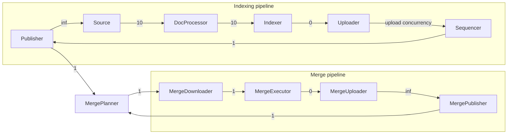

The Indexer serializes and packages splits inline before sending them to the Uploader.
The MergeExecutor packages merged splits inline, including compaction and delete-task
outputs. These stages share their owning actor's lifecycle, health checks, and failures;
there are no separate serialization or packaging actors or mailboxes. Serialization I/O
metrics now use the `indexer` component, and uploader backpressure applies directly to
the Indexer or MergeExecutor. Delete-task pipeline observations report packaging failures under `delete_task_executor` and no
longer include a `packager` entry.

